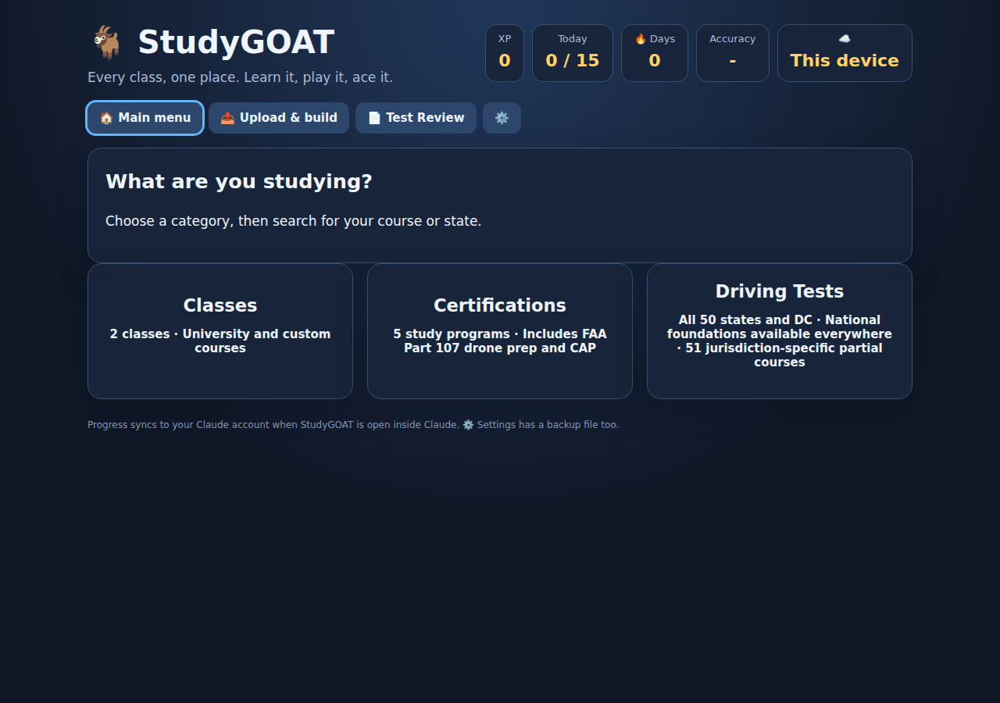
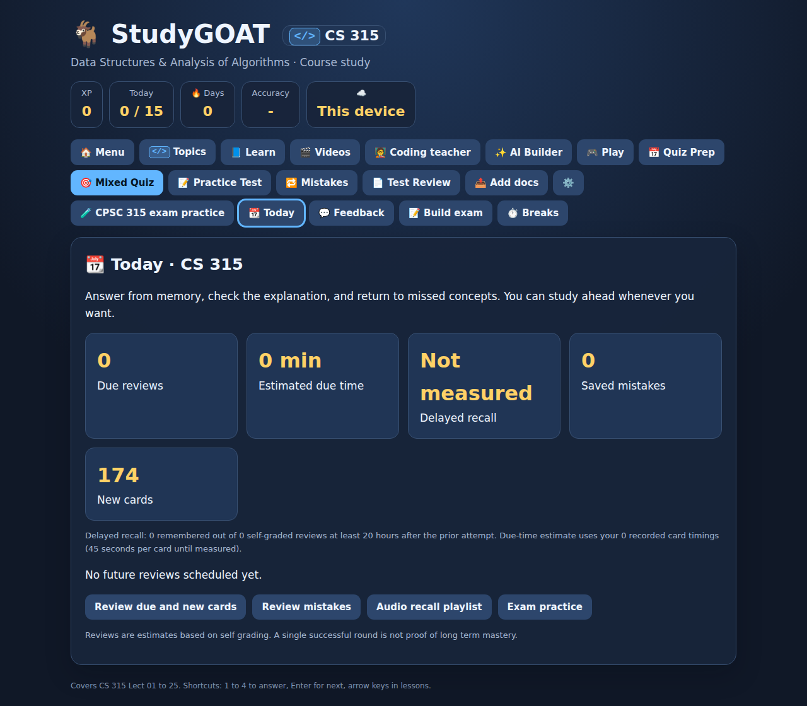
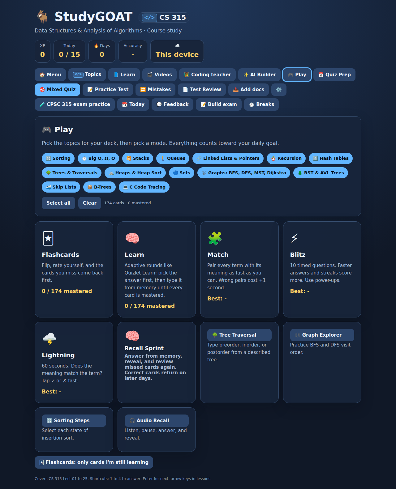
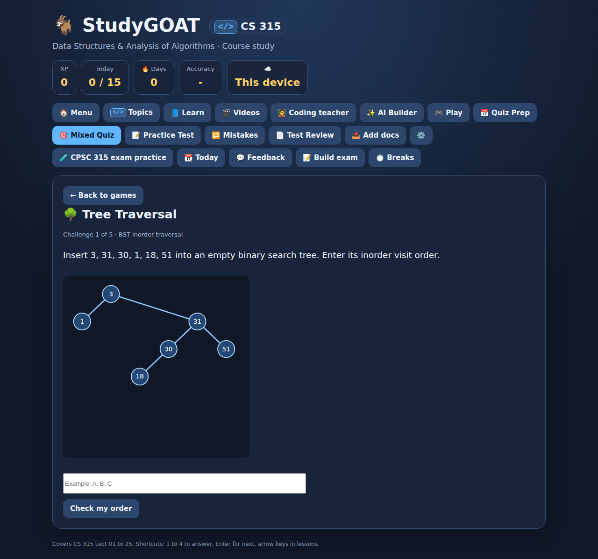
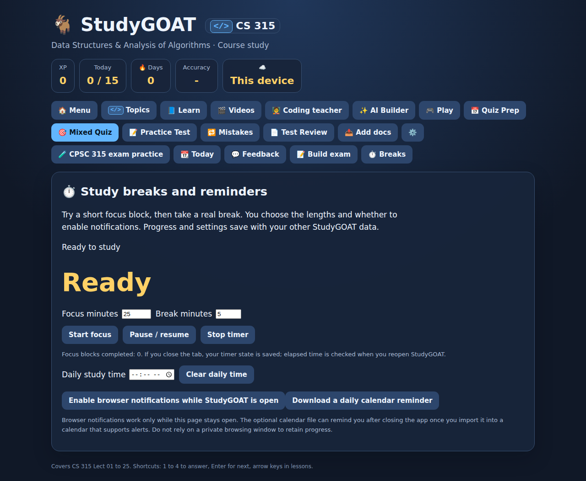
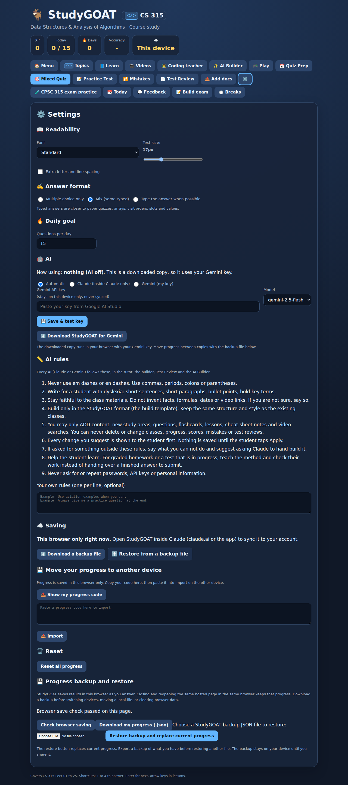

# Download and use StudyGOAT

StudyGOAT works in a browser. You can [open the hosted app](https://test3457890.github.io/StudyGOAT/StudyGOAT.html) without installing anything, or download a copy to keep on your computer. Built-in lessons, cards and games do not need an AI key.

## Option A: Open the hosted app (easiest way to keep progress)

1. Open [StudyGOAT](https://test3457890.github.io/StudyGOAT/StudyGOAT.html) in a normal Firefox, Chrome, or Edge window. Bookmark that exact address. Avoid private or incognito browsing if you want results to stay saved.
2. Choose a course from the library. The example below uses the built-in course library.

   

3. Choose **Today** to see due cards, saved mistakes, a delayed recall measure and an estimate for your due reviews. The estimate learns from the time you spend on cards; it is not an exam grade.

   

4. Use **Learn** for explanations, **Play** for flashcards and games, **Build exam** for a practice test, and **CPSC 315 exam practice** when studying CS 315. Tree and graph games now generate different examples.

   

   

5. Choose **Breaks** to set a focus block and a break. A timer can be paused, and its state is saved. A daily time creates an in-page reminder while StudyGOAT is open. If the browser allows it on the hosted HTTPS site, you may opt into system notifications while the page is open. To get an alert after closing StudyGOAT, download the calendar reminder file and import it into your calendar, then check your calendar's own alert settings.

   

6. Your answers, scores, missed questions, game sessions and settings save as you work. Return to the **same bookmarked address in the same browser** after shutting down your computer. In **Settings**, use **Check browser saving** and **Download my progress (.json)** to keep a private backup.

   

## Option B: Download the repository

1. Visit the [StudyGOAT GitHub repository](https://github.com/test3457890/StudyGOAT). Click **Code**, then **Download ZIP**. On Windows, open Downloads, right-click the ZIP, choose **Extract All**, and open the extracted folder.
2. Keep **StudyGOAT.html** and the **courses** folder together. Open **StudyGOAT.html** in a modern browser. Opening only a copied HTML file without its `courses` folder leaves out the add-on course programs and games.
3. For predictable saved progress in a downloaded copy, serve the extracted folder from the same local address every time. If Python is already installed, open Command Prompt in that folder and run `py -m http.server 8765`. Visit [http://localhost:8765/StudyGOAT.html](http://localhost:8765/StudyGOAT.html). Keep the Command Prompt window open while studying. Reuse the same port and browser on later days.
4. If you prefer to double-click **StudyGOAT.html**, the core app still opens, but browsers can handle saved data for `file:` pages differently. Export a backup from **Settings** after a session. Do not assume a copied or renamed file will automatically find progress from the old path.

## Moving or restoring progress

1. In your current StudyGOAT copy, open **Settings → Download my progress (.json)**. Keep the downloaded file private; it contains your results and notes. You can also use **Show my progress code** for a copy-and-paste backup.
2. Open the new copy. In **Settings**, select the JSON file under **Choose a StudyGOAT backup**, then choose **Restore backup and replace current progress**. This replaces results in the new browser, so back them up first if they matter.
3. Reopen **Today** and check your due count and recent results. The hosted site and `localhost` are separate browser origins, so they need a manual backup and restore when you move between them.

## What notifications can and cannot do

An ordinary page can show reminders and browser notifications while it remains open and permission is granted. It cannot promise a notification after every browser tab and the computer are closed. The downloadable daily calendar file offers a separate reminder after import into a compatible calendar. Audio uses browser voices; results and feedback remain local unless you choose to export or share them.

For maintainers: see [Product Position and AI Handoff](Product%20Position%20and%20AI%20Handoff.md). For screenshots of the other modes, see [the gallery](screenshots/README.md).
