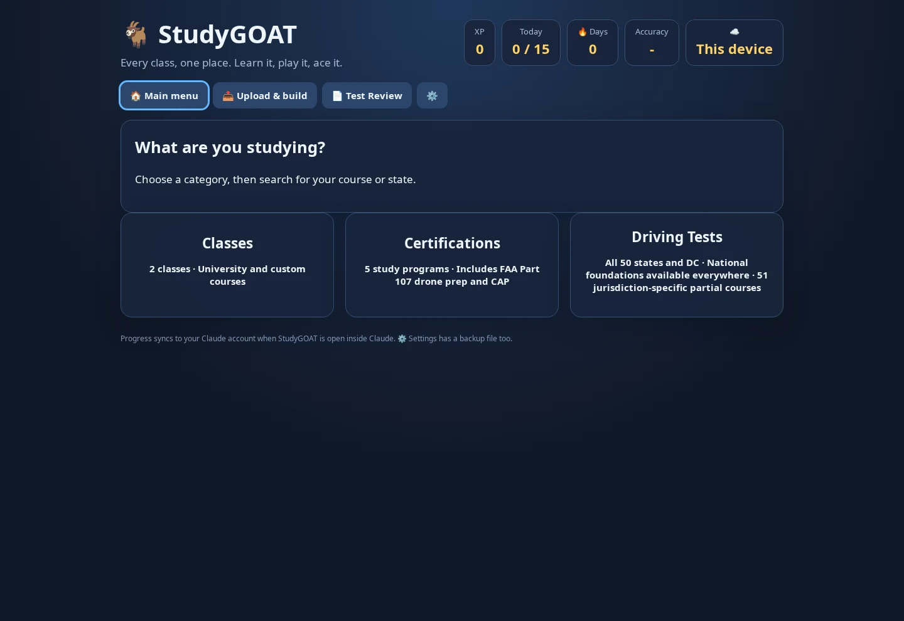
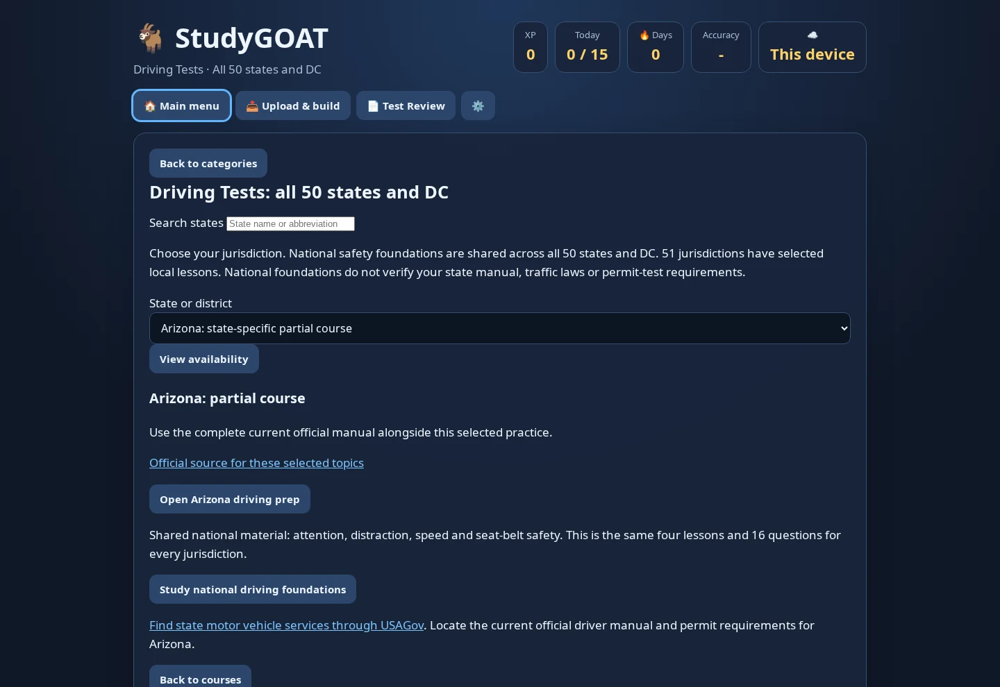
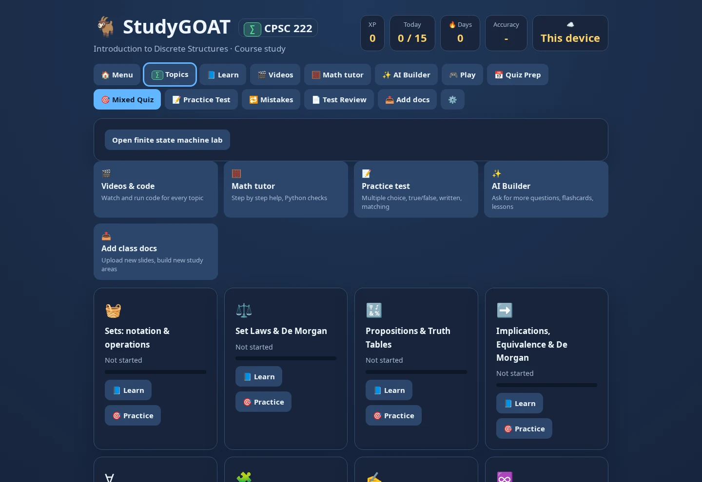
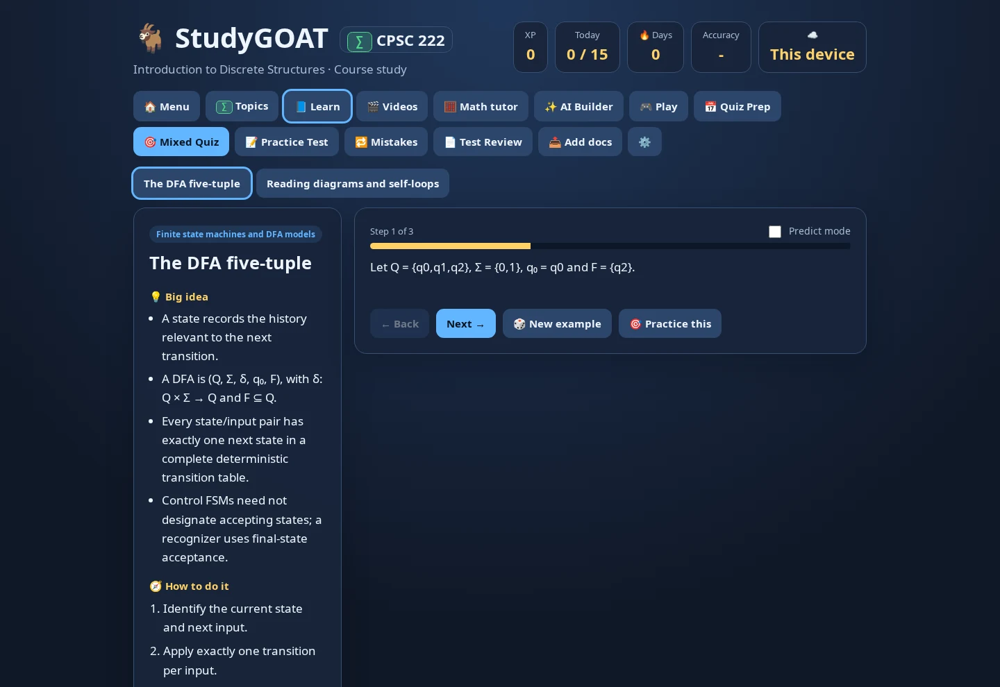
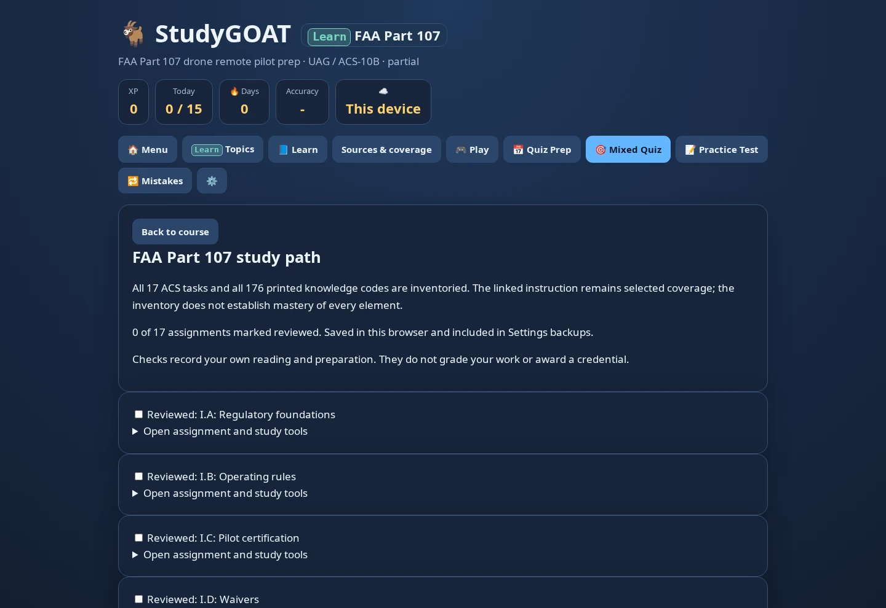
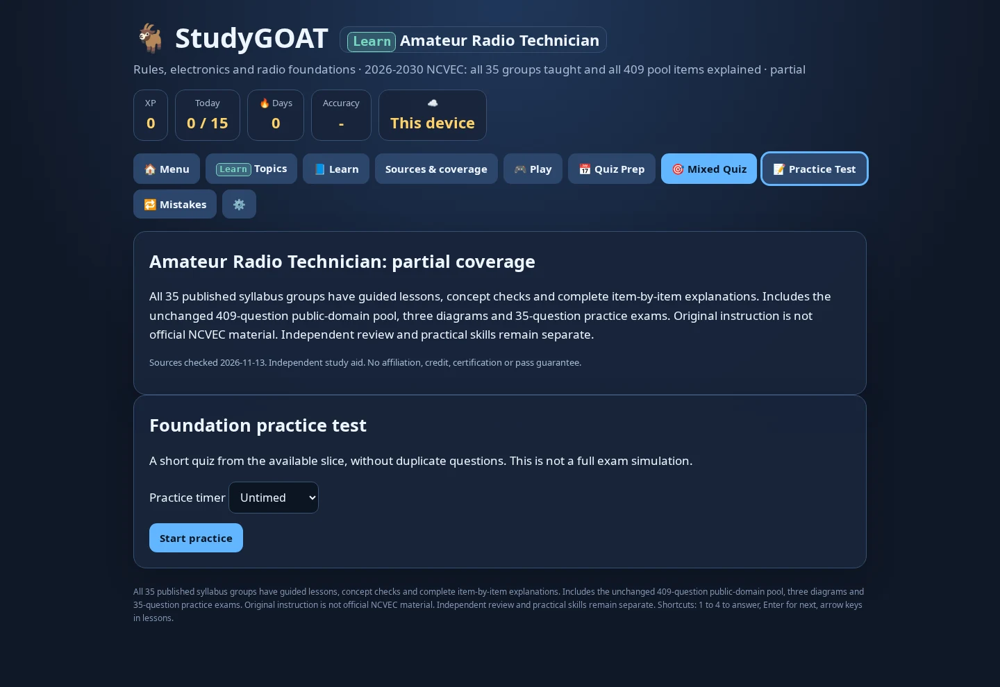

# StudyGOAT screenshots

Captured from the app with a fresh browser profile and built-in study material. The phone image uses a narrow browser viewport.

Select an image to open it at full size.

| Course library | Classes |
| --- | --- |
|  |  |

| Certification library | Driving test directory |
| --- | --- |
|  |  |

| Discrete structures topics | Guided finite-state machine lesson |
| --- | --- |
|  |  |

| Multiple-choice practice quiz | Study games and flashcards |
| --- | --- |
|  |  |

| FAA Part 107 study path | Amateur Radio Technician practice setup |
| --- | --- |
|  |  |

| Course library on a phone-width screen |  |
| --- | --- |
|  |  |
